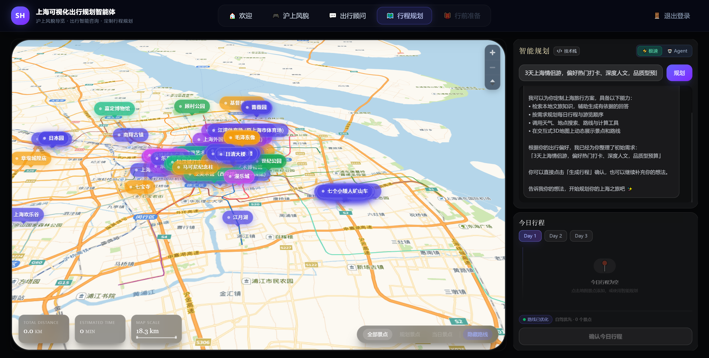
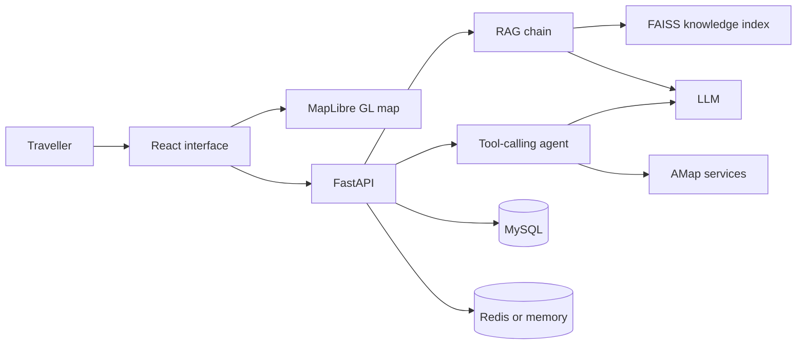

# Shanghai Visualized Travel Planning Intelligent Agent

An independent full-stack project that combines FAISS-based retrieval,
LangChain tool calling, structured itinerary generation, and an interactive
MapLibre GL travel map for exploring Shanghai.

> **Demo video:** [Watch the full 6:46 demonstration on Bilibili](https://www.bilibili.com/video/BV1jopQ6vEo1/).



## Core Features

- **RAG-assisted travel planning:** retrieves local Shanghai travel knowledge
  from a FAISS index before generating advice and structured itineraries.
- **Four-tool agent:** can search nearby places, calculate driving routes,
  retrieve local knowledge, and query real-time weather through server-side
  tool calls.
- **Fast, Agent, and Smart modes:** Smart mode uses transparent keyword rules
  to select Fast or Agent execution and falls back to Fast mode after a
  15-second Agent timeout.
- **Interactive map storytelling:** presents places, day-by-day itineraries,
  and dynamic routes on a tilted MapLibre GL map. React Three Fiber is used for
  supporting visual effects elsewhere in the interface.
- **Full-stack persistence:** FastAPI, MySQL, and optional Redis-backed session
  memory support itinerary storage and multi-turn conversations.

## Architecture



The browser never receives the LLM credential. It calls the FastAPI service,
which owns model access, retrieval, and tool execution.

## Verified Results

- 3 conversation modes: Fast, Agent, and Smart.
- 4 callable tools: place search, route calculation, knowledge retrieval, and
  weather lookup.
- 15-second Agent timeout with automatic Fast-mode fallback.
- TypeScript production build and Python unit tests are included in the release
  checklist.

Latency figures are intentionally omitted until they can be measured against a
configured external model endpoint. This repository does not present simulated
timings as measured results.

## Tech Stack

| Layer | Technologies |
| --- | --- |
| Frontend | React 19, TypeScript, Vite, Tailwind CSS, MapLibre GL |
| Visual effects | Three.js, React Three Fiber, GSAP, Framer Motion |
| Backend | FastAPI, Pydantic, SQLAlchemy, Uvicorn |
| AI | LangChain, FAISS, BGE Chinese embeddings, Volcengine Ark-compatible LLM |
| Data and tools | MySQL, Redis, AMap Web Services |
| Delivery | Docker Compose, Nginx |

## Project Structure

```text
.
|-- backend/
|   |-- app/api/          # FastAPI routes
|   |-- app/services/     # RAG, agent, memory, and routing logic
|   |-- app/models/       # SQLAlchemy models
|   |-- app/schemas/      # Request and response models
|   `-- tests/            # Lightweight unit tests
|-- frontend/
|   |-- src/components/   # Product pages and visual components
|   |-- src/lib/          # API, map, route, and planning clients
|   `-- public/           # Author-approved portfolio images
|-- docker/nginx.conf
|-- docker-compose.yml
`-- .env.example
```

## Quick Start

### Docker Compose

Requirements: Docker Desktop with Compose support and at least 6 GB of free
memory for the embedding model and application services.

```bash
cp .env.example .env
# Add your own server-side model and AMap credentials to .env.
docker compose up --build
```

Open:

- Application: <http://localhost:8080>
- Backend health: <http://localhost:8001/health>
- Interactive API documentation: <http://localhost:8001/docs>

The first backend start downloads the configured embedding model and creates a
local FAISS index under `backend/data/faiss_index/`. That generated index is not
committed.

### Local Development

Backend:

```bash
cd backend
python -m venv .venv
# Windows: .venv\Scripts\activate
# macOS/Linux: source .venv/bin/activate
pip install -r requirements-dev.txt
copy .env.example .env  # use cp on macOS/Linux
uvicorn app.main:app --reload --port 8001
```

Frontend:

```bash
cd frontend
npm ci
copy .env.example .env  # use cp on macOS/Linux
npm run dev
```

## API Overview

| Method | Path | Purpose |
| --- | --- | --- |
| `GET` | `/health` | Service health |
| `POST` | `/api/v1/chat` | RAG chat with memory |
| `POST` | `/api/v1/chat/agent` | Explicit tool-calling Agent mode |
| `POST` | `/api/v1/chat/smart` | Heuristic Fast/Agent routing |
| `POST` | `/api/v1/chat/plan` | Structured RAG itinerary |
| `POST` | `/api/v1/chat/plan/enhanced` | Agent + RAG itinerary |
| `DELETE` | `/api/v1/chat/history` | Clear the active conversation |
| `GET/POST` | `/api/v1/plans` | Itinerary persistence |

Conversation endpoints accept an optional `X-Session-Id` header.

## Security and Configuration

- Never commit `.env` files. The repository includes placeholders only.
- LLM keys and AMap Web Service keys belong in the backend configuration.
- `VITE_AMAP_WEB_KEY` is browser-visible by design. Restrict it to approved
  domains in the AMap console before deployment.
- Rotate any credential that was previously placed in a frontend environment
  file or compiled browser bundle.
- CORS defaults are suitable for local demonstration only; restrict origins for
  an internet deployment.

## Limitations

- Smart routing is a deterministic keyword heuristic, not a learned confidence
  classifier.
- Route quality and live weather depend on external service availability.
- The bundled default knowledge corpus is intentionally small; generated FAISS
  indexes and third-party source documents are excluded from the public repo.
- This is a portfolio demonstration, not a production booking or navigation
  service.

## License

Copyright (c) 2026 Haolei Xu. All rights reserved. The code is public for
portfolio review and educational inspection; reuse requires written permission.
See [LICENSE](LICENSE) and [ATTRIBUTION.md](ATTRIBUTION.md).
